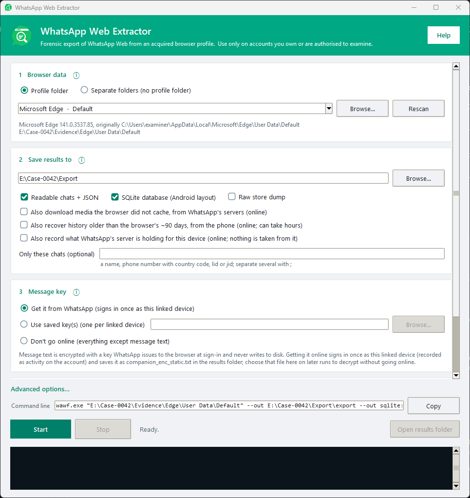
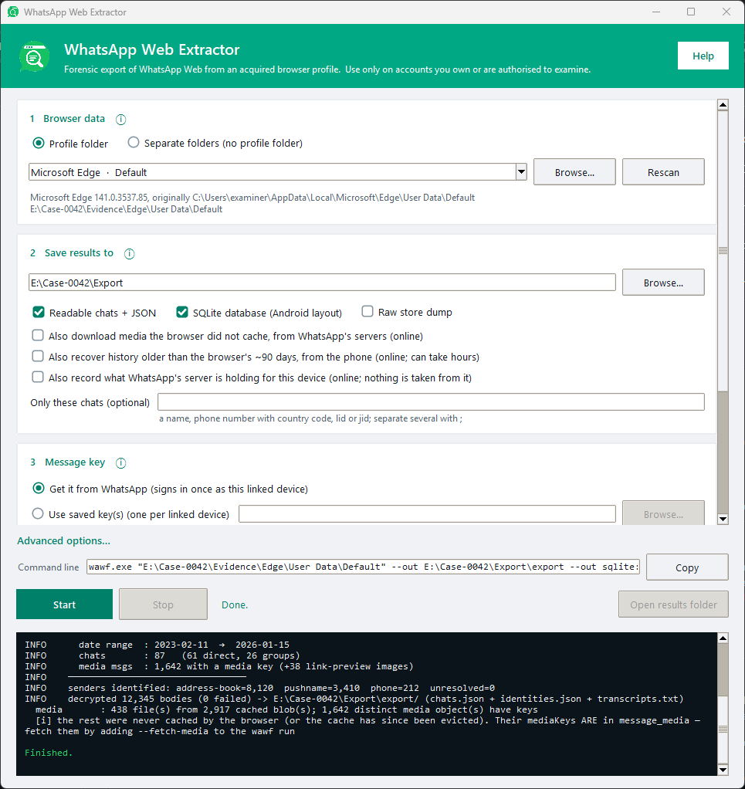

<p align="center">
  
</p>

<h1 align="center">WhatsApp Web Extractor</h1>

<p align="center">
  <b>Forensic export of WhatsApp Web from a browser profile on disk.</b><br>
  Firefox and Chromium (Chrome, Edge, Brave, Opera) · Windows, Linux and macOS · command line or window
</p>

<p align="center">
  <a href="../../releases/latest"></a>
  <a href="LICENSE"></a>
</p>

<p align="center">
  
</p>

> **Authorized use only:** your own account, or a lawful investigation with permission.

> **Risk to the account.** The default run (to capture the key), `--queue` and `--history` sign in to
> WhatsApp as the account's linked device, using a client WhatsApp did not write; `--fetch-media`
> downloads from WhatsApp's CDN.

## What it does

Point it at a browser profile (or a copy of one) and it reads WhatsApp Web's own stores, decrypts them
and writes an export an examiner can read, check and hand over:

- **Message text, decrypted.** The at-rest key is captured by signing in once as the linked device, or
  read from a key file captured earlier, so later runs work fully offline. A wrong key is refused,
  never turned into garbage.
- **Several output formats.** A readable transcript; `chats.json`, `identities.json` and
  `contacts.csv`; an Android-layout `msgstore.db` + `wa.db` that Android WhatsApp parsers already read;
  and a raw dump of every store, record for record.
- **Every sender named.** lid, phone number, address-book name and the contact's own name are
  correlated from the profile itself; where none is known the identifier is printed as it is, never
  guessed.
- **Media** recovered from the browser's cache and checked against each message's hash, with
  `--fetch-media` for what the browser never cached.
- **More than the browser holds.** `--history` asks the phone for messages older than the browser's
  window; `--queue` records what WhatsApp's server is holding for the device without taking it.
- **Chain of custody by default.** Every file read, every decryption and every output is recorded,
  with SHA-256 hashes, in a SQLite case database beside the export.
- **One conversation only**, when that is all an examination covers (`--chat`).

The profile is only read, never written. The phone is not modified.

## Quick start

```powershell
wawf <PROFILE> --out D:\case\out              # capture the key (signs in once), decrypt everything
wawf <PROFILE> --offline --out D:\case\out    # never go online: everything except message text
wawf <PROFILE> --key companion_enc_static.txt --out D:\case\out   # decrypt offline with a saved key
wawf                                          # no arguments: open the window
```

`<PROFILE>` is the browser profile folder, for example
`%LOCALAPPDATA%\Microsoft\Edge\User Data\Default`; `wawf -h` lists the locations on your machine.

## Get it

### Windows — use the `.exe` (no Python needed)

Download **`wawf-windows-x64.exe`** from the [latest release](../../releases/latest), then run it from a terminal:

```powershell
wawf-windows-x64.exe <PROFILE> [options]
```

The binary is unsigned. On a machine with **Smart App Control** enabled, Windows may refuse to run it
with *"An Application Control policy has blocked this file"*. That block is reputation-based rather
than signature-based — it applies to a binary Windows has not seen before, and can clear by itself
after a while. Smart App Control **cannot be re-enabled once turned off**, so disabling it is a
one-way decision about the whole machine, not a workaround; running from Python instead avoids the
question entirely. See [BUILD.md](BUILD.md).

`--history` (pulling messages older than the browser cache from your phone) runs inside the `.exe`
too: the linked-device client and the Signal protocol are implemented in Python, so no Node.js is
needed. See [Recovering older history](docs/history.md).

### Linux / macOS — run with Python

```bash
pip install -r requirements.txt          # cryptography, cramjam, websocket-client, ccl_chromium_reader
python3 wawf.py <PROFILE> [options]
```

<sub>(or install them by hand: `pip install cryptography cramjam websocket-client` and
`pip install "git+https://github.com/cclgroupltd/ccl_chromium_reader.git@ef840de30221c4d65bc96d2f4d9057e9ef2f526d"`, the commit the tool is tested against)</sub>

(A prebuilt `wawf-linux-x64` binary is also on the [releases page](../../releases/latest), and you can
build your own binary for any OS with `pyinstaller wawf.spec` — see [BUILD.md](BUILD.md).)

## Use

**There are no sub-commands.** Point it at a browser profile and it does the whole job — recover the
device credentials, capture the at-rest key (reconnect), and decrypt:

```bash
wawf <PROFILE>
```

`<PROFILE>` is the browser profile folder (Chromium: `Default`, `Profile 1`, ...; Firefox: the profile
folder, or `--origin` for its `web.whatsapp.com` storage folder). Nothing is auto-detected — which profile
gets examined is always your explicit choice. `wawf -h` prints the profile locations for your machine as
full, copy-pasteable paths.

**Prefer a window?** Double-click `wawf-windows-x64.exe`, or run `wawf` with no arguments (`wawf --gui`
also works). It finds the profiles on the machine that hold WhatsApp Web — for any Chromium- or
Firefox-based browser — or takes a copied profile, or the stores on their own; then where to save and how
to get the key. Everything else the command line offers is under *Advanced options…*. The window shows
the exact command it will run, live, with a **Copy** button: every run from the window is an ordinary
command-line run, with the same audit trail, and can be repeated from a terminal or quoted in a report.

<p align="center">
  
  <br><sub>After a run: the command line it ran, and its log. (All names, numbers and paths in these screenshots are made up.)</sub>
</p>

> **Two files in the first output folder are key material, not evidence:** `companion_enc_static.txt`
> and `creds_in.json`. Remove both before an export is copied, shared or attached to a report; see
> [Where the key comes from](docs/key.md).

## Documentation

| | |
|---|---|
| [Running wawf](docs/usage.md) | acquiring the profile, pointing at loose stores, every option, `--chat`, examples and exit codes |
| [Output formats](docs/output.md) | text, JSON, SQLite and `raw`; how senders are named; checking an export; media |
| [What a browser holds](docs/browser-contents.md) | what WhatsApp Web keeps on disk, compared with the phone |
| [Where the key comes from](docs/key.md) | capturing the at-rest key, decrypting offline, and running with no key |
| [Chain of custody](docs/chain-of-custody.md) | the case database written beside every export |
| [Recording the server queue](docs/server-queue.md) | `--queue`: what WhatsApp's server is holding for the device |
| [Recovering older history](docs/history.md) | `--history`: asking the phone for messages older than the browser's window; diagnostics |
| [Building](BUILD.md) | building the binaries yourself, and the release checklist |

## Known issues

- **Messages the `.exe` cannot decrypt stay unread.** During `--history` the default Python engine (the
  one in the `.exe` and the Linux binary) never asks a sender to re-encrypt a message it cannot
  decrypt. Each such message is kept as received in `received_journal.jsonl` and counted at the end of
  the pass, but its text is not recovered. The Node engine (`WAWF_HISTORY_ENGINE=node`) does ask, so
  the sender can send it again. In the other direction it is the opposite: when the *phone* cannot
  decrypt a history request, the Python engine sends it again on a new Signal session, while the Node
  engine starts the new session but does not send the request again.
- **The phone's signed prekey signature is not checked.** When the Python engine starts a new Signal
  session with the phone (after the phone asks for a request again), it uses the signed prekey from
  the phone's key bundle without verifying that key's signature. The bundle comes from WhatsApp's
  server over the authenticated connection; libsignal (the Node engine) does verify it.

## License

Apache License 2.0; see [LICENSE](LICENSE).
